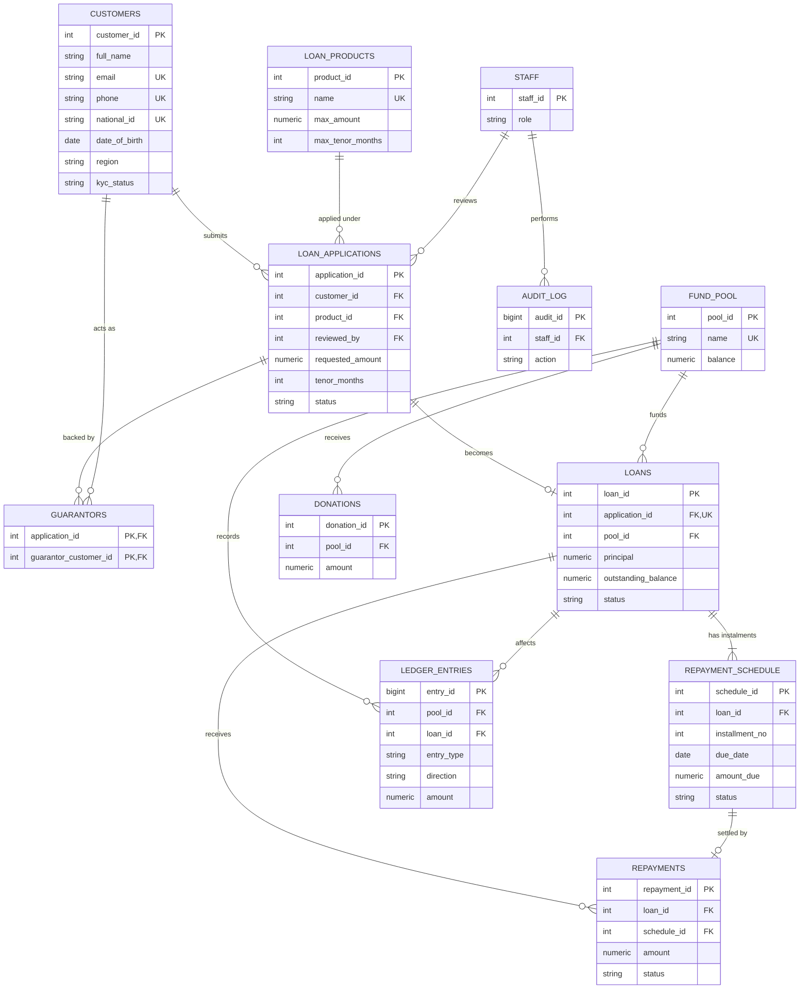

# ER Diagram: InterestFree Lend

Mermaid source (renders on GitHub). Export a PNG/SVG of this into `screenshots/er-diagram.png`
(e.g. paste into https://mermaid.live) so it can also be embedded in the LMS document.

## Relationship notes
- **Customer ↔ Application:** one-to-many.
- **Application ↔ Guarantor ↔ Customer:** many-to-many resolved by the `guarantors` junction table (composite PK).
- **Application → Loan:** one-to-zero-or-one (`loans.application_id` is UNIQUE); a loan exists only after disbursement.
- **Loan → Schedule:** one-to-many; `(loan_id, installment_no)` is UNIQUE.
