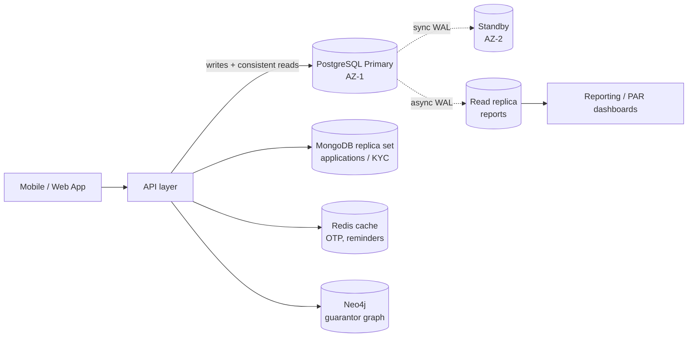

# Proposed cloud architecture: InterestFree Lend

| Component | Consistency need | Replication | Reason |
|---|---|---|---|
| PostgreSQL ledger/loans | Strong | sync standby + async replicas | money correctness |
| MongoDB applications | Tunable (majority writes) | 3-node replica set | availability |
| Redis | Eventual / disposable | optional | speed layer |
| Neo4j | Strong within cluster | causal cluster | risk analysis |
